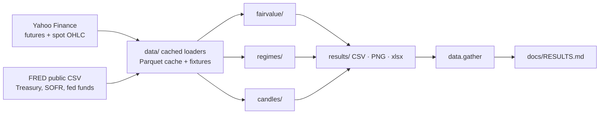

# futures-research-toolkit

Three small, reproducible research projects on free market data, built to mirror the three
projects in the Futures First PS-II notice for the International Markets (derivatives trading)
internship. Everything below comes from one real run (`make e2e`, data to 2026-10-09).

| PS project | Module | What it does |
|---|---|---|
| Pricing & Risk Engine for STIR products | [`fairvalue/`](fairvalue) | Cost-of-carry fair value `F = S·exp((r+u−q−c)·T)` for ES, gold and WTI crude futures against market prices; implied dividend/convenience yield; spot / rate / time-to-expiry scenario grids; Excel export with live formulas. |
| Correlation study & Regime Dynamics | [`regimes/`](regimes) | Calendar spreads and butterflies on the short-rate curve, correlation structure per regime, a Gaussian HMM written from scratch plus a transparent threshold detector, checked against known stress episodes. |
| Robust Candlestick Pattern Recognition | [`candles/`](candles) | 14 classic patterns (hammer, doji, marubozu, engulfing, harami, morning/evening star, three soldiers/crows, …) labelled on every candle of 5 futures, then tested for real predictive power with multiple-testing correction. |



## Results (real data)

**Fair value (cost of carry).** Model vs market futures price, mean absolute gap:
ES 7.9 bps over 2,033 days (median 5.4); gold 40.6 bps over 1,954 days; WTI crude 78.8 bps over
1,687 days (median 26.2, so a fat tail around contract rolls). The yield that makes the model
exact is itself informative: implied S&P dividend yield 1.28% (median), against 1.4% assumed.
ES fair value moves about 0.151 index points per 1 bp of rate. Treasury futures are not priced:
that needs cheapest-to-deliver and conversion factors, which free data does not provide.

**Regimes.** 3-state HMM on 10,936 daily FRED observations (1982-01-04 to 2026-10-08) for
8 spreads/butterflies (e.g. 5y−1y, fly 2·2y−1y−5y). It flags the 2008 crisis, the 2020 COVID
shock and the 2022 hiking cycle (3 of 3 episodes; 84%, 48% and 82% of those days in the
stressed state). Mean daily-change correlation across the structures rises from 0.059 (calm) to
0.080 (stressed), a 36% lift; the biggest flip is 5y−1y vs the 2·2y−1y−5y fly, from −0.078 to
+0.291. The HMM and the threshold detector agree on 76% of days. The 2013 taper tantrum is
**not** flagged as stressed (0%), which is reported as is.

**Candlesticks.** 11,802 pattern events on 22,351 daily bars (ES, NQ, GC, CL, ZN, 2009-2026),
42 pattern×horizon tests. After Benjamini-Hochberg correction 4 are significant, and **none in
the direction the pattern claims**: shooting star (bearish) is followed by *up* moves more often
than chance (hit rate 41% vs 47% base), the morning star (bullish) underperforms its base rate,
and the two doji results reflect the market's general upward drift, not the pattern. Mean hit
rate across patterns is 49.6% against a 50.4% base rate. Textbook candlestick patterns do not
beat chance here; the engine's value is a reproducible way to find that out.

Full numbers: [`docs/RESULTS.md`](docs/RESULTS.md). Module write-ups:
[`docs/fairvalue.md`](docs/fairvalue.md), [`docs/regimes.md`](docs/regimes.md),
[`docs/candles/index.md`](docs/candles/index.md). Plain-English guide with interview Q&A:
[`docs/WALKTHROUGH.md`](docs/WALKTHROUGH.md).

## Data sources and limits (be sceptical, as you should)

- **Yahoo Finance via yfinance**: continuous front-month futures (`ES=F`, `GC=F`, `CL=F`,
  `ZN=F`, `NQ=F`) and spot (`^GSPC`, GLD). These are *not* exchange tick data and are not
  roll-adjusted; rolls create gaps and the contract month behind each price is reconstructed
  from the exchange calendar, so time to expiry can be off by weeks near rolls.
- **FRED public CSV (no key)**: Treasury constant-maturity yields, SOFR, fed funds, WTI spot.
- **STIR proxy**: individual STIR futures contract histories are not free. The spread/butterfly
  study therefore uses yield-curve spreads and butterflies from FRED as a stand-in for the
  calendar spreads and butterflies a STIR trader quotes. The mathematics and regime method
  carry over; the numbers are not those of listed STIR contracts.
- The S&P dividend yield (1.4%) is an assumption; gold spot uses the GLD ETF as proxy.
- No trading strategy, backtest P&L or forecast is claimed.

## Run it

```bash
make install     # venv + pinned-range deps
make test        # offline, fixtures only (also what CI runs)
make e2e         # all three modules on real data (needs network once; cached in .cache/)
make all         # lint + test + e2e
make fixtures    # refresh the small committed sample data
```
Shared interface and conventions: [`docs/CONTRACTS.md`](docs/CONTRACTS.md). Repository layout:
`data/` loaders · `fairvalue/` · `regimes/` · `candles/` · `results/` outputs · `docs/`.
